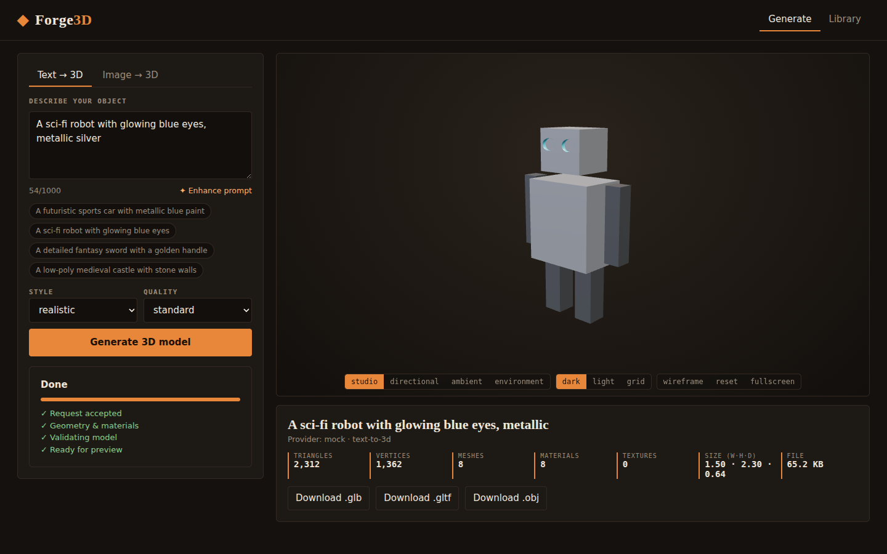
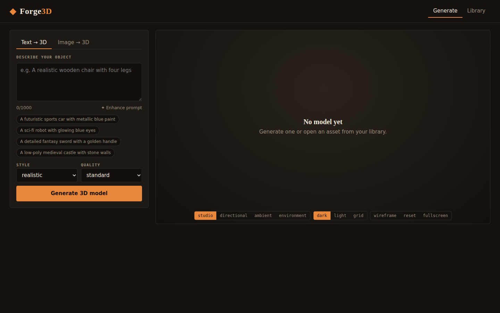
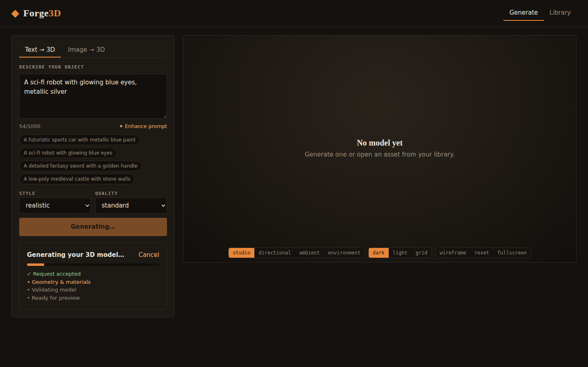
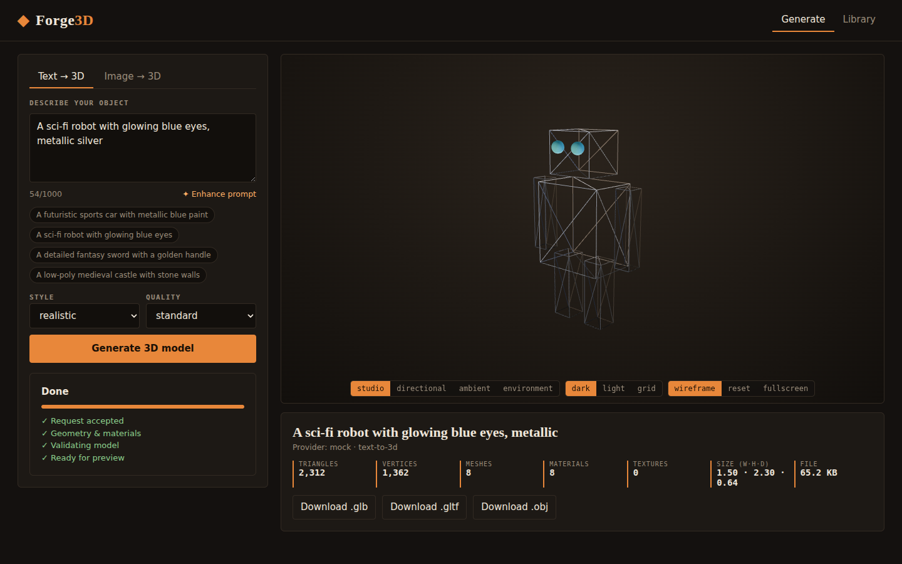
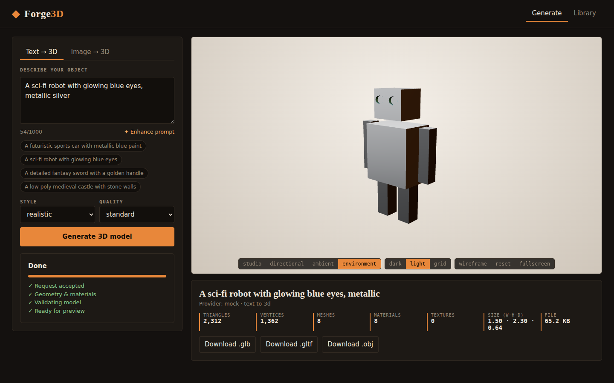
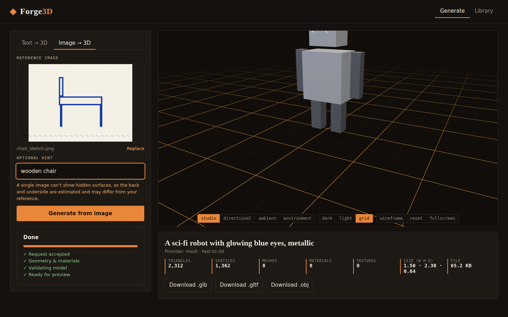
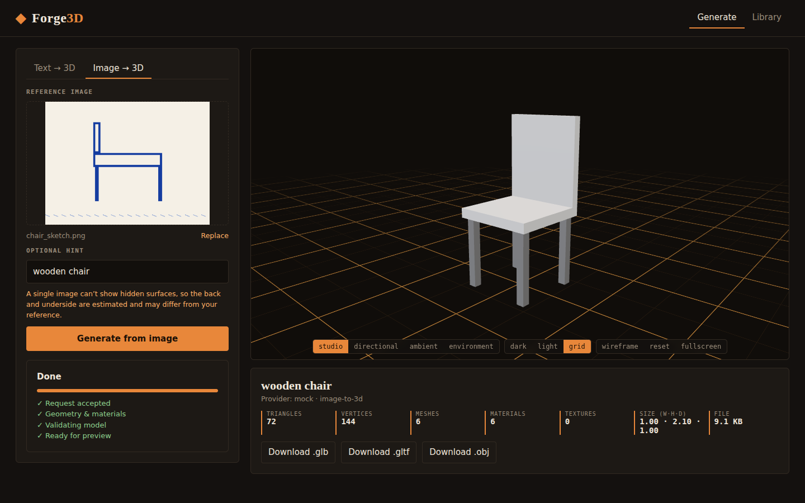
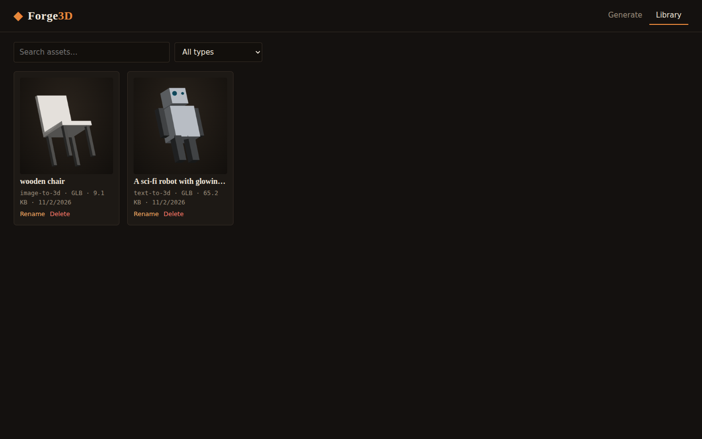
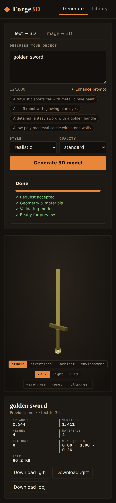

# Forge3D-3D Asset Generator from Text / 2D Images

Web app that turns a text prompt or a reference image into an interactive 3D model you can inspect, manage and export
(GLB / glTF / OBJ+MTL). React + TypeScript + React Three Fiber frontend, FastAPI backend, SQLite storage.



## Quick start
```bash
# backend
cd backend && pip install -r requirements.txt 
python -m uvicorn app.main:app --port 8000
# frontend (new terminal)
cd frontend 
npm install 
npm run dev        # http://localhost:5173
# or one-port production style: (cd frontend && npm run build) then open http://localhost:8000
```
Works out of the box with the **offline mock provider** (no API key). To use Tripo3D: copy `.env.example` → `.env`, set
`GEN_PROVIDER=tripo` and `TRIPO_API_KEY=…`.

## Tests
```bash
scripts/test.sh          # 50 backend + 43 frontend tests + typecheck
scripts/test.sh --e2e    # + headless-Chromium end-to-end run that regenerates screenshots/
```

## What is real and what is not — please read
* **The mock provider is not AI.** It builds simple procedural GLB models from prompt keywords (chair, sword, castle, car,
  dog, helmet, robot, ring, tree, else a generic orb) and tints them from colour words or the average colour of an
  uploaded image. It exists so the entire pipeline (jobs, viewer, library, export, tests) works offline and for free.
* **Tripo3D adapter**: written against Tripo's documented task API (`/task`, `/upload`, polling, model download) and unit
  tested with a mocked HTTP transport. It has **not** been run against the live service (no key/network here); field names
  or output keys may need small adjustments.
* **Shap-E** is described in the proposal as an optional local backend; it is **not implemented** — add a class in
  `backend/app/providers/` implementing `Provider` and register it in `providers/__init__.py`.
* **Export**: GLB is the provider's file as-is. glTF embeds the buffer. OBJ export writes geometry + base colours only;
  it ignores node transforms and image textures (documented limitation — use Blender for textured OBJ).
* **Not included**: user accounts/auth, Redis worker, mesh optimisation/decimation, Blender pipeline, multi-view input,
  Tailwind (plain CSS is used). Docker files are provided but were not built in this environment.
* Prompt "enhancement" is a rule-based text expander (editable before generating), not an LLM call.

## Layout
`backend/app` (api, providers, processing, db, jobs) · `backend/tests` · `frontend/src` (components, three, services,
utils, `__tests__`) · `docs/architecture.md` · `scripts/` · `screenshots/`

## Screenshots
| | |
|---|---|
|  |  |
|  |  |
|  |  |
|  |  |
